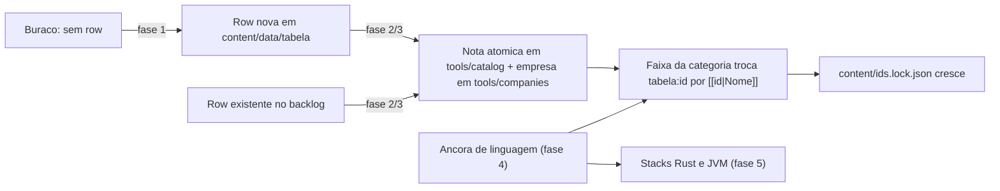

# Design Document

## Overview

A expansão ataca três problemas medidos no catálogo: ciclo de linguagem incompleto (P0), categorias sem opções reais e ausência de âncoras de linguagem (P1), e ausência de stacks Rust e JVM corporativo (P2). Tudo se resolve dentro do contrato vigente: nota atômica por Template-Ferramenta, faixas de três opções por categoria, rows de backlog em `content/data/tabela/*.json`, ids congelados em `content/ids.lock.json`. Não há mudança de schema, de validador nem de site: o design inteiro é sobre onde criar cada artefato e em que ordem.

### Objetivos de design

1. Cada linguagem do vocabulário tem, ao fim, um caminho completo dentro do kit: âncora -> framework -> testes -> build/lint -> ORM -> cliente HTTP.
2. Converter backlog em nota sempre pela mesma mecânica: row existe -> nota atômica -> faixa troca `tabela:id` por `[[id|Nome]]`.
3. Nenhuma nota sem fonte e data; nenhuma row sem url e preço verificado.
4. Escopo contido: ~70 notas novas (24 do ciclo, 34 de evidência, 12 âncoras), 2 categorias novas, 15 rows novas, 2 stacks. O catálogo passa de 282 para ~352 notas.

### Matriz do ciclo de linguagem (P0)

Célula `nota` cria nota atômica; `embutida` fica coberta pela âncora (Requisito 4.2); `lacuna` fica registrada na categoria; `existe` já tem nota hoje.

| Linguagem | frameworks_testes | build_lint_formatacao | orm_acesso_dados | frameworks_backend | clientes_http_api |
|---|---|---|---|---|---|
| python | existe (pytest) | nota: ruff | nota: sqlalchemy | existe (django, fastapi) | nota: httpx |
| javascript/typescript | nota: vitest | nota: eslint, prettier, biome | existe (prisma, drizzle_orm) | existe (express, fastify) | existe (axios, ky) |
| java | nota: junit5 | nota: maven (row nova) | existe (hibernate_orm) | existe (spring_boot) | existe (okhttp) |
| kotlin | nota: kotest | existe (gradle) | existe (hibernate_orm) | existe (spring_boot) | existe (okhttp) |
| go | nota: testify (row nova) | embutida (go test, gofmt) | nota: gorm | existe (chi, fiber) | embutida (net/http) |
| rust | nota: cargo (row nova) | nota: cargo, clippy | nota: sqlx, diesel | nota: actix_web | nota: reqwest |
| csharp | existe (xunit_net) | embutida (dotnet format) | nota: entity_framework_core | existe (asp_net_core) | embutida (HttpClient) |
| php | nota: phpunit | embutida | embutida (Eloquent em laravel) | existe (laravel, symfony) | embutida (Guzzle) |
| ruby | nota: rspec | embutida (RuboCop) | embutida (ActiveRecord em rails) | existe (ruby_on_rails) | embutida (net/http) |
| swift | embutida (XCTest/Swift Testing) | embutida | lacuna | nota: vapor (row nova) | embutida |
| dart | embutida (package:test) | embutida (pub) | lacuna | lacuna | embutida |

Conversões opcionais fora da matriz (não bloqueiam a spec): gin, echo, hono, nestjs, flask, rocket, sequelize, typeorm.

### Decisões de design

| # | Decisão | Alternativas consideradas | Motivo |
|---|---|---|---|
| D1 | Âncoras de linguagem na categoria nova `linguagens_programacao` (grupo Frameworks por camada) | (a) sem âncoras; (b) nota em fundamentals; (c) uma nota "linguagens" só | A ausência sentida pelo usuário é exatamente "não achei onde começar com Java/Rust". `kotlin.md` já é nota de linguagem e vira precedente. Fundamentals guarda conceitos atemporais; linguagem é a dimensão de filtro do catálogo de ferramentas |
| D2 | Toolchain embutida coberta pela âncora, sem rows | Rows para `go test`, `gofmt`, `dotnet format`, XCTest | Itens embutidos não são decisões de adoção; inflar o backlog com stdlib cria ruído nas faixas |
| D3 | Uma opção por linguagem por categoria do ciclo; sem representante -> lacuna registrada (padrão das stacks) | Converter as 647 entradas `tabela:` | Escopo finito e verificável; o resto do backlog é decisão editorial de futuras specs |
| D4 | Logging em categoria nova `logs_estruturados` (grupo Bibliotecas), um representante por linguagem: pino, zap, structlog, logback, serilog, tracing | Espalhar por categorias por linguagem | Linguagem é filtro, não categoria; hoje não existe nenhuma nota de log no kit |
| D5 | CLI libs (`clap`, `cobra`) na categoria nova `bibliotecas_cli` (grupo Bibliotecas) | Ignorar; ou jogar em build_lint_formatacao | São bibliotecas para construir CLIs, não ferramentas de build; categoria própria as deixa filtráveis |
| D6 | Ordem das fases: rows -> notas do ciclo -> evidência -> âncoras -> stacks | Âncoras primeiro | Âncora sem ciclo vira beco sem saída: ela aponta para categorias que ainda não têm opções |
| D7 | Fabricante novo ganha nota em `tools/companies/`; comunidade usa `<id>_comunidade` | String solta no campo empresa | O campo `empresa` é link `[[...]]`; precedentes `tokio_empresa`, `warp_rust_comunidade` |
| D8 | Row convertida em nota permanece na tabela JSON | Remover a row quando a nota nasce | A tabela é índice e a faixa é evidência; okhttp tem nota e row coexistindo. A regra nova (R1.6) elimina o beco sem saída: faixa sempre aponta `[[id|Nome]]` quando a nota existe |
| D9 | Categorias novas com `status: rascunho` e `guia: []` | Já nascer conectadas ao guia | A conexão com `catalogos/ferramentas.yaml` é decisão editorial posterior (fora de escopo) |
| D10 | Ids novos entram no `ids.lock.json` no mesmo commit da nota | Append único no fim | O lock é espelho do conteúdo; a suite continua verde commit a commit |

### Arquitetura do fluxo de conversão

### Template de cada artefato novo

- **Row**: copiar o formato das rows existentes (id, nome, categorias por nome legível, empresa, url, preco com modelo/usd/unidade/status/fonte/data).
- **Nota de ferramenta**: seguir `axum.md` e `warp_rust.md` (open-source: precoUSD 0, licença lida na data, alternativas em links quando existirem).
- **Nota de categoria**: seguir `frameworks_testes.md` (id, tipo categoria, slug, grupo, 4 faixas + essenciais, seções Descrição, Como aparece, Faixas, Relacionamentos).
- **Âncora de linguagem**: nota de ferramenta com `tipos: [LINGUAGEM, SOFTWARE]` (ou `SOFTWARE` se o validador recusar), uma categoria `linguagens_programacao`, corpo com Quando Utilizar/NÃO Utilizar, toolchain embutida e links das categorias do ciclo.
- **Stack**: seguir `api_transacional_eventos.md` (fontes com status_revisao e proxima_revisao, quando_usar, quando_evitar, categorias em links, lacuna por faixa vazia).

### Referências

- `content/pt-BR/hubs/hub_tools.md` (vocabulário de plataformas, linguagens, porte, segmentos, modelo de contratação, grupos).
- `content/pt-BR/tools/categories/frameworks_testes.md` e `gateway_api_service_mesh.md` (padrão de categoria com faixas e `tabela:`).
- `content/pt-BR/tools/catalog/axum.md` (padrão de nota open-source).
- `content/pt-BR/stacks/api_transacional_eventos.md` (padrão de stack com fontes e lacuna).
- `docs/prd.md` e `.kiro/steering/product.md` (visão de produto; o kit dinâmico e navegável exige que faixas levem a notas reais).

## Consequences

- O catálogo passa de 282 para ~352 notas; o `hub_tools` ganha duas categorias novas; o grafo do site cresce na mesma proporção sem mudança de código.
- As faixas das categorias tocadas ficam sem becos sem saída para as linguagens do vocabulário.
- O backlog de conversão total (entradas `tabela:` fora do escopo) continua registrado para futuras specs, e a regra R1.6 impede que novas dead-ends sejam criadas.
