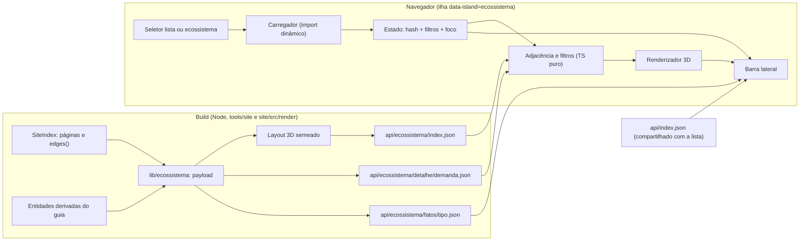
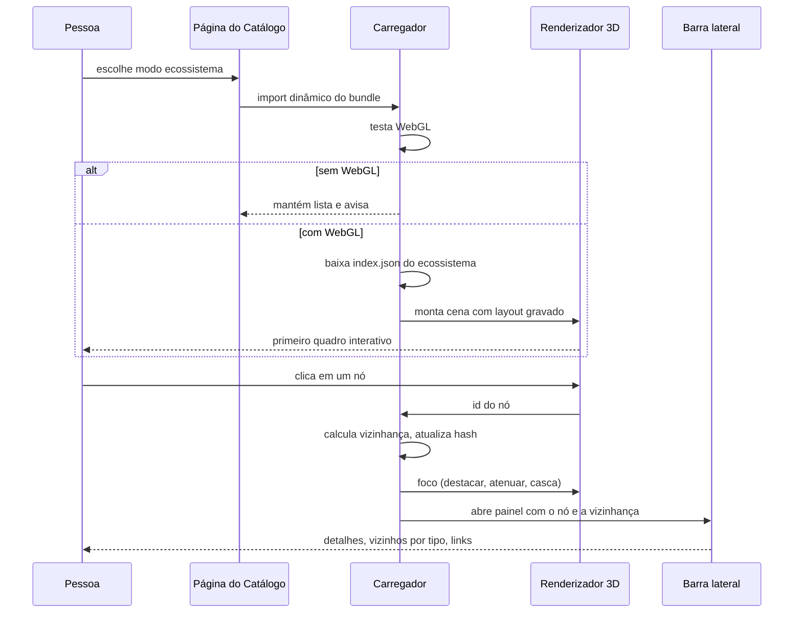

# Design Document

## Overview

O Ecossistema 3D é um modo de visualização do Catálogo (`ecossistema`, ao lado de `lista`) que desenha todas as entidades do kit como um grafo único em WebGL. Clicar em um nó o expande e destaca a vizinhança, e uma barra lateral mostra os detalhes. Os requisitos estão em `requirements.md`. Esta spec estende `experiencia-fluxos-catalogo` (Perspectiva `3d`, contrato do Modelo de Grafo, estado no hash, facetas do Catálogo).

### Objetivos de design

1. Abrir rápido e continuar legível com mais de 2.000 nós e mais de 12.000 pares de nós ligados.
2. Reusar o que existe: `SiteIndex.edges()`, `api/index.json`, as facetas do Catálogo, o padrão de ilha (`data-island`) e o estado no hash.
3. Layout **estável e determinístico**: o mapa mental da pessoa não muda ao filtrar ou ao reabrir.
4. Zero custo fora do modo `ecossistema`: nenhuma página paga pelo Three.js.
5. Lógica de grafo (camadas, adjacência, filtros, foco) em TypeScript puro, testável no Vitest sem navegador. O renderizador é uma casca fina.

### Decisões de design

| # | Decisão | Alternativas consideradas | Motivo |
|---|---|---|---|
| D1 | `3d-force-graph` 1.80.2 + `three` 0.187.0 (ambos MIT), carregados por `import()` dinâmico no bundler do Astro | Three.js direto com `d3-force-3d`; Sigma ou Cytoscape (2D); deck.gl | É a referência pedida, cobre câmera, picking e rótulos. 2D contradiz o requisito. deck.gl é maior e mais complexo. Um renderizador próprio fica como otimização futura de tamanho (ver Orçamento) |
| D2 | **Layout pré-calculado no build** e gravado no payload. O cliente não roda simulação de forças | Simulação de forças no navegador | Primeiro quadro imediato, resultado determinístico (semente fixa), sem CPU gasta depois de estabilizar, e filtros não embaralham o mapa |
| D3 | **Arestas desenhadas em lote** (um `LineSegments`) pelo nosso renderizador. A biblioteca desenha só os nós | Arestas nativas da biblioteca (um objeto por aresta) | Com cerca de 12.600 pares, um objeto por aresta é o gargalo previsível. O lote usa uma geometria. Validado por spike (Tarefa de desempenho) antes de seguir |
| D4 | Payload **colunar** (nós e arestas como arrays de inteiros) em `api/ecossistema/`, separado do `graph.json` | Reusar `graph.json` | Estimativa medida: 95 kB gzip em colunar contra 180 kB do `graph.json`, já sem os 70 gateways. O `graph.json` continua como está |
| D5 | Camada `detalhe` em **shards por Demanda**, carregados ao pedir | Um arquivo único; um arquivo por tarefa | 1.681 nós de detalhe cabem em 13 arquivos. Um arquivo por tarefa gera 151 pedidos pequenos |
| D6 | Foco calcula o arranjo local no cliente: vizinhos em casca esférica ao redor do nó, o resto atenuado no lugar | Reposicionar o grafo todo | Barato (O(vizinhos)) e preserva o mapa. A animação de 1 s é só interpolação de câmera e de poucos nós |
| D7 | Cor e forma por **grupo visual** (redundância para daltonismo), tipo fino na legenda e no rótulo | Uma cor por tipo (29 tipos) | A paleta Okabe-Ito tem 8 cores. Por tipo, as cores colidiriam |
| D8 | Estado no hash, reaproveitando o módulo de filtros do Catálogo. Câmera em `history.state` | Câmera no hash | O hash ficaria longo e instável. A câmera só importa no voltar do navegador (Requirement 11.4) |

### Referências

- `3d-force-graph`: https://github.com/vasturiano/3d-force-graph
- `docs/architecture.md` (convenção de ilhas, API estática) e `docs/site-map.md`.
- Medições: `site/dist/pt-BR/api/graph.json` (2.182 nós, 23.164 arestas, 180 kB gzip) e bundle de `3d-force-graph` com esbuild (ver Orçamento de desempenho).

## Architecture



### Camadas do código

| Local | Responsabilidade | Roda em |
|---|---|---|
| `lib/ecossistema/camadas.ts` | Mapa `Tipo` para `Camada` e para grupo visual. `Record<Tipo, ...>` exaustivo | Build e cliente |
| `lib/ecossistema/payload.ts` | Constrói e valida (Zod) o payload colunar e os shards | Build |
| `lib/ecossistema/layout.ts` | Layout de forças 3D com semente fixa (`d3-force-3d`, devDependency) | Build |
| `lib/ecossistema/adjacencia.ts` | Adjacência simétrica, vizinhança por profundidade, agrupamento por tipo | Build e cliente |
| `lib/ecossistema/filtro.ts` | Filtros por camada, faceta e texto (E entre facetas, OU dentro da faceta) | Cliente e testes |
| `lib/ecossistema/foco.ts` | Seleção de vizinhos (teto e agrupamento) e arranjo em casca | Cliente e testes |
| `site/src/render/api.ts` | Emite os JSON de `api/ecossistema/` | Build |
| `site/src/ecossistema/` | `main.ts` (montagem), `estado.ts` (hash), `renderer.ts` (interface), `renderer-3d.ts` (adaptador), `barra-lateral.ts`, `legenda.ts` | Cliente |
| `site/src/components/Ecossistema.astro` | Casca HTML do modo, marcada com `data-island="ecossistema"` | Build |

O módulo de filtros e a faceta do Catálogo (spec `experiencia-fluxos-catalogo`, Requirement 11) são **o mesmo código**. Isso entrega o Requirement 6.7 (paridade entre `lista` e `ecossistema`) por construção.

### Fluxo de abertura e de foco



### Camadas de granularidade

| Camada | Tipos | Padrão | Como carrega |
|---|---|---|---|
| `nucleo` | ferramenta, categoria, modelo, empresa, caso-de-uso, funcionalidade, benchmark, tecnica, padrao, algoritmo, estrutura-de-dados, licenca, stack, guia-pratico, jornada, competencia, certificacao, demanda, papel, rito, requisito, abordagem, estrategia, hub | Ativa | `api/ecossistema/index.json` |
| `fluxo` | raia, tarefa, artefato, tipo-de-artefato, variavel | Ativa | `api/ecossistema/index.json` |
| `detalhe` | decisao (gateway), subtarefa, pergunta, no (início, fim, chamada), playbook, celula | Inativa | `api/ecossistema/detalhe/<demanda>.json`, sob demanda |

O tipo `hub` fica em `nucleo` e **oculto por padrão** por um filtro próprio (Requirement 2.8), não por camada, para a pessoa poder ligá-lo sem carregar nada novo.

Novo tipo no schema sem entrada em `camadas.ts` falha em compilação (`Record<Tipo, ...>`), e o build também falha com o nome do tipo (Requirement 3.10).

## Components and Interfaces

### Interface do renderizador

O cliente depende só desta interface. O adaptador de `3d-force-graph` é a única implementação desta spec, e a spec posterior de identidade visual pode trocá-lo sem mexer na lógica (mesmo princípio do Requirement 17.10 da spec de fluxos).

```ts
export interface EcossistemaRenderer {
  /** Monta a cena. Posições vêm do payload (x, y, z). */
  montar(host: HTMLElement, dados: CenaInicial): void;
  /** Atualiza quais nós e arestas aparecem, sem recalcular posições. */
  definirVisiveis(nos: ReadonlySet<number>, arestas: ReadonlyArray<number>): void;
  /** Destaca um conjunto, atenua o resto e arranja a vizinhança em casca. */
  focar(foco: EstadoDeFoco | null, opcoes: { animar: boolean }): void;
  /** Move a câmera. */
  enquadrar(alvo: 'tudo' | number, opcoes: { animar: boolean }): void;
  aoClicarNo(cb: (indice: number) => void): void;
  aoClicarFundo(cb: () => void): void;
  aoPassarNo(cb: (indice: number | null) => void): void;
  lerCamera(): CameraSalva;
  restaurarCamera(c: CameraSalva): void;
  destruir(): void; // libera geometrias, materiais, texturas e o laço de animação
}
```

### Estado e hash

```ts
export interface EstadoEcossistema {
  modo: 'lista' | 'ecossistema';
  foco: string | null;          // id do nó focado
  profundidade: 1 | 2;
  camadas: ReadonlySet<'nucleo' | 'fluxo' | 'detalhe'>;
  hubs: boolean;                // exibir hubs de navegação
  texto: string;
  facetas: Readonly<Record<string, ReadonlySet<string>>>;
}
```

Formato do hash (parâmetros estilo query, ordem canônica para a mesma URL representar o mesmo estado): `#m=eco&f=<id>&d=2&l=nucleo,fluxo,detalhe&h=1&q=<texto>&tipo=ferramenta,modelo&categoria=<id>`. Os mesmos nomes de faceta valem na `lista`, então alternar o modo mantém os filtros (Requirement 1.3). Atualizar o hash usa `history.replaceState` para mudanças de filtro e `pushState` para mudanças de foco, assim o botão Voltar do navegador percorre o histórico de foco.

### Foco e vizinhança

```ts
export interface EstadoDeFoco {
  no: number;
  vizinhos: ReadonlyArray<number>;     // índices exibidos
  grupos: ReadonlyArray<{ tipo: string; total: number; expandido: boolean }>;
  truncado: boolean;
}
export function calcularFoco(adj: Adjacencia, no: number, profundidade: 1 | 2, visiveis: ReadonlySet<number>, opcoes: { teto: number }): EstadoDeFoco;
```

Regras (resolvem as questões em aberto 3 e 6 da spec, para aprovação do dono):

- **Profundidade 1:** todos os vizinhos visíveis. Se passam de 150, entram **agrupados por tipo** (um nó-grupo por tipo, com a contagem), e a pessoa expande um grupo por vez (Requirement 4.10).
- **Profundidade 2:** teto de **400 nós** exibidos. Vizinhos diretos entram primeiro. O restante entra por ordem de ligações com o conjunto já escolhido. O que passa do teto vira o resumo "+N" no painel lateral.
- Hubs de navegação nunca entram como vizinhos de profundidade 2 (evitam que o foco cubra o grafo inteiro).

### Barra lateral

| Região | Fonte do dado |
|---|---|
| Nome, tipo, área, descrição, URL | `api/index.json` (já carregado pela lista, cache compartilhado) |
| Vizinhança por tipo, com contagens | Adjacência em memória |
| Fatos por tipo (ferramenta: categoria, empresa, licença, preço com fonte e data; tarefa: raia, demanda, papel) | `api/ecossistema/fatos/<tipo>.json`, baixado só ao focar o primeiro nó daquele tipo |
| Links "Abrir página", "Abrir fluxo", "Ver no diagrama" | Rotas do `index.json` e `api/flows` |

O painel é um `<aside>` com `role="complementary"`. Em telas com menos de 768 px vira painel inferior. Esc fecha o painel e sai do foco. A lista de vizinhos é navegável por teclado e serve de forma textual completa do grafo (Requirement 10.4).

### Legenda e codificação visual

| Grupo visual | Cor (Okabe-Ito) | Forma | Tipos |
|---|---|---|---|
| Fluxos | `#0072B2` | esfera | demanda, raia, tarefa, papel, rito, requisito |
| Artefatos e variáveis | `#56B4E9` | cubo | artefato, tipo-de-artefato, variavel |
| Catálogo (mercado) | `#E69F00` | octaedro | ferramenta, categoria, empresa, caso-de-uso, funcionalidade, modelo, benchmark, stack, guia-pratico |
| Fundamentos | `#009E73` | cone | tecnica, padrao, algoritmo, estrutura-de-dados, licenca, abordagem, estrategia |
| Aprendizado | `#CC79A7` | tetraedro | jornada, competencia, certificacao |
| Hubs | `#999999` | anel | hub |

Cor e forma identificam o grupo, e o tipo fino aparece no rótulo ao passar o ponteiro, na legenda (com caixas para ligar e desligar tipos) e na barra lateral. As formas usam geometrias e materiais compartilhados por grupo (poucos objetos, custo baixo). O tamanho do nó cresce com o grau, com teto, para a pessoa achar os nós centrais.

### Arestas

- Uma aresta visual por par de nós (sem direção). Os `kind` do par ficam numa lista, mostrada no painel e na dica.
- Arestas de `kind: body` (wikilinks no texto) têm opacidade menor que as relações tipadas, para não dominar a visão (resolve a questão em aberto 4).
- Em Foco, só as arestas que tocam o `No_Focado` e a Vizinhança mantêm opacidade cheia. As demais caem para a atenuada.

## Data Models

### Payload principal (`api/ecossistema/index.json`)

Colunar, para caber no orçamento. Posições em inteiros (unidades de mundo ×10).

```ts
export interface PayloadEcossistema {
  versao: 1;
  locale: 'pt-BR' | 'en';
  tipos: string[];            // tabela de tipos
  grupos: string[];           // tabela de grupos visuais
  camadas: Record<string, 'nucleo' | 'fluxo' | 'detalhe'>; // tipo -> camada
  kinds: string[];            // tabela de kinds de aresta
  // nos[i] = [id, tipoIdx, nome, x, y, z, grau]
  nos: Array<[string, number, string, number, number, number, number]>;
  // arestas[j] = [origemIdx, destinoIdx, kindIdx]
  arestas: Array<[number, number, number]>;
}
```

Notas:
- Índices (não ids) nas arestas reduzem o tamanho. O cliente guarda `Map<id, índice>`.
- A área e o grupo derivam de `tipo` por `camadas.ts` e `layer`, e não vão no payload por nó.
- Medição: com 2.112 nós (sem gateways) e 22.546 arestas dirigidas, o formato colunar pesa 390 kB bruto e **95 kB gzip**. As posições somam cerca de 25 kB gzip estimados. O total esperado é cerca de 120 kB gzip, abaixo do limite de 200 kB (Requirement 9.4).

### Shard de detalhe (`api/ecossistema/detalhe/<demanda>.json`)

```ts
export interface ShardDetalhe {
  versao: 1;
  demanda: string;
  // nos[i] = [id, tipoIdx, nome, paiId]; o pai é o nó do nucleo ou fluxo ao qual o item se liga
  nos: Array<[string, number, string, string]>;
  // arestas entre itens de detalhe e destes para nós já conhecidos (por id, não por índice)
  arestas: Array<[string, string, number]>;
}
```

O cliente posiciona cada item de detalhe num anel pequeno ao redor do pai (posição determinística por hash do id). O shard cobre a demanda inteira. A tela exibe só os itens ligados ao nó em Foco (ver Questões em aberto, item 1).

**Premissa a verificar na primeira tarefa:** os itens de detalhe saem de `lib/guide/entities.ts` (entidades derivadas com `relacoes`) e não de `SiteIndex.pages`, que hoje só tem 70 gateways entre eles. O gerador do shard lê as entidades derivadas diretamente.

### Fatos por tipo (`api/ecossistema/fatos/<tipo>.json`)

```ts
export interface FatosPorTipo {
  versao: 1;
  tipo: string;
  itens: Record<string, Array<{ rotulo: string; valor: string; fonte?: string; data?: string; naoVerificado?: boolean }>>;
}
```

Só os tipos com renderizador de fatos têm arquivo (ferramenta, modelo, certificacao, tarefa, raia, demanda). A lista cresce por dados, sem mudar o cliente. Todo dado volátil traz `fonte` e `data`, ou `naoVerificado: true` (Requirement 5.5, spec de fluxos Requirement 14).

### Layout

`lib/ecossistema/layout.ts` roda `d3-force-3d` no build:

- Semente fixa (`randomSource` com gerador congruencial linear semeado) e número fixo de passos (300), então a mesma entrada gera o mesmo resultado.
- Forças: repulsão (many-body com aproximação de Barnes-Hut), mola por aresta (peso menor para `body`), e uma atração fraca de cada nó para a âncora da sua Área (três âncoras, em triângulo), que forma os aglomerados do Requirement 2.3.
- Hubs de navegação ficam **fora da simulação** e são posicionados no centroide dos vizinhos. Isso evita que `hub_tools` (944 ligações) distorça tudo.
- Os valores são arredondados para inteiros antes de gravar, para o JSON ser estável entre execuções e plataformas.
- Custo esperado de build: segundos. O design mede e registra o tempo.

### Zod

O payload e o shard têm schema Zod em `lib/ecossistema/payload.ts`, com `version`. O build falha com o id do nó ou da aresta inválida (Requirement 7.5). Arestas com índice fora do intervalo falham a validação (Requirement 7.6).

## Correctness Properties

Invariantes que a implementação preserva e que os testes verificam.

1. **Exaustividade das camadas.** Todo `Tipo` do schema tem exatamente uma Camada e um grupo visual. Um tipo novo sem entrada falha na compilação e no teste (Requirements 3.1 e 3.10).
2. **Simetria da vizinhança.** Para todo par (A, B): B está na vizinhança de A se e somente se A está na de B (Requirements 7.7 e 12.6).
3. **Sem aresta órfã.** Toda aresta do payload aponta para índices existentes, e toda aresta de um shard aponta para ids existentes no payload ou no shard (Requirement 7.6).
4. **Independência da ordem.** O resultado de aplicar um conjunto de Filtros não depende da ordem de aplicação (Requirements 6.3 e 12.6).
5. **Paridade com a lista.** Para qualquer combinação de Filtros, o conjunto de entidades do modo `ecossistema` é igual ao do modo `lista`, por usarem o mesmo módulo (Requirement 6.7).
6. **Omissão por camada.** Uma aresta é visível se e somente se seus dois extremos estão visíveis. Desativar `detalhe` nunca deixa aresta pendurada (Requirement 3.7).
7. **Determinismo do layout.** A mesma entrada gera os mesmos bytes de payload (Requirements 8.2 e 8.5).
8. **Foco limitado.** Em profundidade 1 com mais de 150 vizinhos, nenhum vizinho individual é exibido antes de expandir seu grupo. Em profundidade 2, o total exibido não passa de 400 e hubs não entram (Requirement 4.10 e questão 6 da spec).
9. **Round-trip do estado.** Serializar o estado para o hash e desserializar produz o mesmo estado, para qualquer estado válido (Requirements 1.5, 4.11 e 6.6).
10. **Cobertura da Vizinhança no painel.** A lista da Barra_Lateral contém exatamente a Vizinhança calculada a partir do Grafo_de_Dados (Requirements 5.2 e 12.2).
11. **Sem fuga de recursos.** Sair do modo `ecossistema` chama `destruir()`, e a contagem de geometrias e materiais do renderer volta a zero (Requirement 9.9).

## Error Handling

| Situação | Comportamento |
|---|---|
| Sem WebGL ou sem JavaScript | Permanece a `lista`, com mensagem "o Ecossistema exige WebGL" (Requirement 1.6). A página já nasce renderizada no modo `lista` |
| Perda do contexto WebGL (`webglcontextlost`) | Mostra aviso e botão "Recarregar o ecossistema". Mantém o estado do hash |
| Falha ao baixar `index.json` do ecossistema | Mensagem com botão "Tentar de novo" e link para a `lista`. Sem exceção no console |
| Falha ao baixar um shard de detalhe | Aviso no painel ("detalhes indisponíveis"). O resto do grafo continua |
| Falha ao baixar fatos de um tipo | O painel mostra nome, descrição e vizinhos sem os fatos |
| Id do hash inexistente | Abre a visão completa e mostra "entidade não encontrada" (Requirement 4.12) |
| Hash inválido ou parâmetro desconhecido | Ignora o parâmetro e segue com o padrão |
| `prefers-reduced-motion` | Câmera salta direto ao alvo, sem animação (Requirement 8.4) |
| Payload inválido no build | O build falha com o id do nó ou da aresta (Requirement 7.5) |
| Tipo sem camada no build | O build falha com o nome do tipo (Requirement 3.10) |
| Conteúdo sem tradução em `en` | Texto em pt-BR com marcador de fallback (Requirement 5.9) |
| Limite de orçamento excedido | A verificação de desempenho falha (Requirement 12.8) |

## Testing Strategy

### Unitários e de propriedade (Vitest, sem navegador)

- `camadas.test.ts`: exaustividade (propriedade 1).
- `adjacencia.test.ts` e `payload.test.ts`: simetria, aresta órfã, índices válidos, round-trip colunar para objeto (propriedades 2 e 3). Rodam sobre o grafo real do build e sobre grafos gerados.
- `filtro.test.ts`: independência da ordem, E e OU, paridade com a filtragem direta de `api/index.json` (propriedades 4 e 5). Usa geração aleatória de filtros com **fast-check** (nova devDependency, MIT).
- `foco.test.ts`: teto, agrupamento, exclusão de hubs (propriedade 8).
- `layout.test.ts`: determinismo (mesmos bytes duas vezes), sem NaN, hubs no centroide (propriedade 7).
- `estado.test.ts`: round-trip do hash e hash inválido (propriedade 9).
- `renderer-contrato.test.ts`: um renderer falso valida que a lógica só usa a interface.

### Navegador (Playwright, `tests/browser/ecossistema.spec.ts`)

- Abre o modo `ecossistema`, confere o número de nós por camada e a legenda.
- Clica em um nó e confere Foco, painel aberto e vizinhança igual à calculada do JSON.
- Alterna camadas e confere que `detalhe` só baixa o shard ao pedir (inspeção de rede).
- Abre URL com hash completo e confere o estado restaurado, e o Voltar do navegador restaurando foco e câmera.
- Simula WebGL indisponível (`--disable-gpu` e remoção do contexto) e confere o fallback para `lista`.
- Falha o teste em qualquer exceção não tratada no console.
- Navegação por teclado na lista de vizinhos e anúncio por `aria-live`.

O CI usa o Chromium headless com renderização por software (SwiftShader). Os testes de comportamento rodam assim. Os testes de quadros por segundo **não** rodam no CI por serem instáveis em software.

### Desempenho

- **No CI (bloqueante):** tamanho gzip do bundle do ecossistema e dos JSON (falha acima do limite), e tempo até o primeiro quadro interativo com CPU 4 vezes mais lenta e limite de 3,0 s no p95 (Requirement 12.8).
- **Local (registrado no design, não bloqueante):** quadros por segundo na rotação da câmera e tempo de entrada em Foco, medidos em hardware de referência anotado no registro de medições. O limite de 30 quadros por segundo (Requirement 9.6) é verificado nessa medição, e o resultado é anexado à PR.
- **Spike de desempenho antes de qualquer outra tarefa:** prova de que 2.112 nós e 12,6 mil pares desenham a 30 quadros por segundo ou mais com arestas em lote (D3). Se falhar, o design reavalia (arestas só da vizinhança, ou nível de detalhe por distância) antes de seguir.

### Orçamento de desempenho

| Medida | Limite proposto | Linha de base medida |
|---|---|---|
| JavaScript carregado só no modo `ecossistema` (gzip) | 450 kB | 406 kB (`3d-force-graph` 1.80.2 e `three` 0.187.0, esbuild, minificado, 1,5 MB bruto) |
| Carregador na página do Catálogo (gzip) | 5 kB | a medir |
| Payload principal por idioma (gzip) | 200 kB | cerca de 95 kB sem posições, cerca de 120 kB com |
| Primeiro quadro interativo (p95, CPU 4 vezes mais lenta) | 3,0 s | a medir |
| Entrada em Foco, sem a animação | 200 ms | a medir |
| Crescimento de `site/dist` | dentro dos 25% somados com a spec de fluxos | a medir |

O limite de 300 kB por página da spec de fluxos vale para a carga inicial. O bundle do ecossistema é carregado depois, só no modo `ecossistema`, no mesmo molde que a spec de fluxos aplica ao Mermaid (carga adiada com limite próprio). **Sinal de alerta:** 406 kB é a linha de base do que o `import` de `3d-force-graph` puxa. Reduzir exige importar `three-forcegraph` e `three` de forma seletiva ou um renderizador próprio, e isso fica como otimização futura se o limite apertar.

### Internacionalização

Todos os rótulos, mensagens e a legenda ficam em `site/src/i18n` (`pt-BR` e `en`). Nomes de entidade vêm do payload do idioma.

## Glossary

- **Camada_de_Granularidade**: `nucleo`, `fluxo` ou `detalhe`. Define o que carrega e o que aparece.
- **Grupo_Visual**: agrupamento de tipos que compartilha cor e forma na legenda.
- **Payload_Colunar**: formato do JSON do ecossistema em arrays de inteiros e tabelas de nomes.
- **Shard**: arquivo de detalhe de uma Demanda, baixado sob demanda.
- **Casca**: arranjo dos vizinhos do No_Focado em uma esfera ao redor dele.
- **Layout_Pre_Calculado**: posições 3D calculadas no build com semente fixa e gravadas no payload.
- **Spike**: experimento curto para validar uma hipótese técnica antes de investir no resto.
- Demais termos (No_Focado, Vizinhanca, Barra_Lateral, Hub_de_Navegacao, Fragmento_de_Estado) estão no Glossary de `requirements.md`.

## Questões em aberto

Decididas pelo dono:

1. **Download do shard (Requirement 3.9):** o design baixa o shard da Demanda inteira e exibe só os itens ligados ao nó em Foco. Aceito.
2. **Orçamento do bundle adiado:** 450 kB gzip, com 406 kB como linha de base. Aceito.
3. **`fast-check`:** aceito como devDependency.

Ainda abertas:

4. **Teto de 400 nós na profundidade 2 e limite de 150 na agrupação** são propostas. Ajustar depois do spike e de uma revisão visual.
5. **Layout reembaralha entre builds.** Como o layout é recalculado a cada build, adicionar um nó pode mover o grafo todo. É aceitável hoje. Se a estabilidade entre versões importar, o layout pode partir das posições do build anterior.
