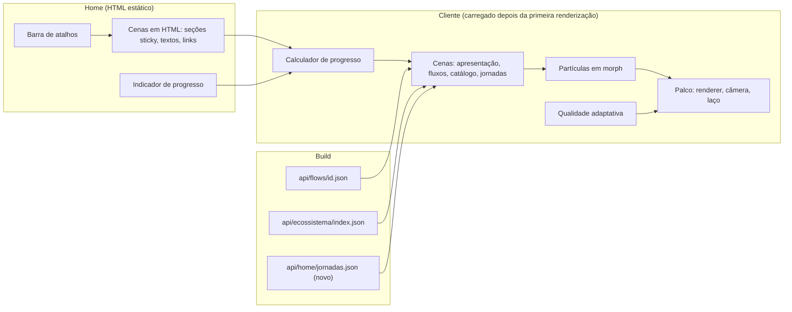

# Design Document

## Overview

A Home passa a ser uma narrativa de rolagem com quatro Cenas em tela cheia, desenhadas em **um único Palco WebGL**. O Palco guarda um sistema de partículas que se **transforma (morph)** de uma Cena para a próxima: as partículas formam as letras do título, depois as raias e os nós de uma Demanda, depois a nuvem do catálogo e por fim a constelação de jornadas e certificações. Linhas, rótulos e links vivem em HTML sobre o Palco. Os requisitos estão em `requirements.md`.

### Objetivos de design

1. Uma única linguagem visual (as partículas) costura as quatro Cenas e dá a sensação de um mesmo espaço.
2. Rolagem nativa: o navegador rola, o código só **lê** o progresso. Nada intercepta roda, toque ou teclado.
3. Um contexto WebGL e um laço de animação para a página inteira, pausados quando nada está visível.
4. Tudo que é informação existe também em HTML. O Palco é decorativo.
5. A lógica que decide progresso, Cena ativa e qualidade é TypeScript puro, testável sem navegador.
6. Mesma experiência no celular, com uma versão reduzida automática quando o aparelho não sustenta.

### Decisões de design

| # | Decisão | Alternativas | Motivo |
|---|---|---|---|
| D1 | Palco único com partículas em morph | Um canvas por Cena; cenas independentes | Um contexto WebGL só. O morph dá continuidade entre Cenas e custa uma geometria (decisão do dono) |
| D2 | Three.js direto, sem `3d-force-graph` | Reusar a biblioteca do ecossistema | A Home não precisa de grafo de forças. Evita cerca de 150 kB de código que a Home não usa (a medir) |
| D3 | Rolagem nativa com `position: sticky`; progresso lido por calculador próprio | GSAP ScrollTrigger; Lenis | Decisão do dono: sem dependência nova. O calculador é uma função de poucas linhas |
| D4 | Título vira malha no Palco, com o shader de água e ímã atual | Manter o canvas próprio | Permite que as letras se desfaçam em partículas na transição (decisão do dono) |
| D5 | Posições-alvo de cada Cena calculadas no cliente a partir dos dados | Pré-calcular no build | Fluxos e jornadas são pequenos. O catálogo já traz posições no payload do ecossistema |
| D6 | Qualidade adaptativa em três níveis, medida em tempo de execução | Detecção só por tipo de aparelho | Aparelhos iguais se comportam de modos diferentes. Mede quadros e desce de nível |
| D7 | Conteúdo em HTML com `aria-hidden` no canvas, mais Fallback_Estatico | Texto desenhado no WebGL | Acessibilidade, busca na página e SEO |

### Referências

- `docs/site-map.md`, `.kiro/specs/experiencia-ecossistema-3d/design.md` (renderizador, cores e formas por tipo, orçamento).
- `site/src/scripts/hero-title.ts` (shader atual do título).
- Hubtown (https://hubtown.co.in/): cenas fixas, cena 3D conduzida pelo scroll.

## Architecture



### Estrutura da página

```html
<main data-layer="home">
  <section class="cena" data-cena="apresentacao" style="--faixa: 220vh">
    <div class="cena-fixa">  <!-- position: sticky; top: 0; height: 100svh -->
      conteúdo em HTML da Cena (h1, texto, links)
    </div>
  </section>
  ... fluxos (--faixa: 320vh), catalogo (--faixa: 280vh), jornadas (--faixa: 280vh) ...
</main>
<canvas id="palco" aria-hidden="true">  <!-- position: fixed; inset: 0; z-index: -1 -->
```

Cada Cena ocupa uma faixa de rolagem (`--faixa`). Dentro dela, a parte fixa fica presa à tela. O calculador devolve o Progresso_da_Cena de 0 a 1 enquanto a faixa passa.

### Linha do tempo (morph entre Cenas)

| Rolagem | Estado do Palco |
|---|---|
| Cena 1, 0 a 0,6 | Título com ondas e ímã. Partículas amostradas das letras |
| Cena 1, 0,6 a 1 | As letras se desfazem em partículas que fluem para as raias |
| Cena 2 | Partículas em raias horizontais. Nós na ordem do fluxo. Arestas reveladas pelo progresso |
| Cena 2 para 3 | Raias se dissolvem e as partículas voam para as posições da nuvem do catálogo |
| Cena 3 | Nuvem por grupo, com contagens em HTML. Rotação lenta da câmera |
| Cena 3 para 4 | A nuvem se contrai em anéis |
| Cena 4 | Certificações em anéis por nível e setores por área. Jornadas e competências como âncoras |

O morph usa dois buffers de posição por partícula (`aPosA`, `aPosB`) e um uniforme `uMix` de 0 a 1. A troca de par acontece no vertex shader, então a página inteira custa uma chamada de desenho.

## Components and Interfaces

### Módulos

| Local | Responsabilidade | Roda em |
|---|---|---|
| `lib/home/progresso.ts` | `progressoDaCena`, `cenaAtiva`, `janelaDeMorph` (funções puras) | Cliente e testes |
| `lib/home/qualidade.ts` | Níveis de qualidade e a regra de descer de nível por tempo de quadro | Cliente e testes |
| `lib/home/layouts.ts` | Posições-alvo das partículas por Cena a partir dos dados (funções puras) | Cliente e testes |
| `site/src/home/palco.ts` | Renderer único, câmera, laço, resize, pausa, descarte | Cliente |
| `site/src/home/particulas.ts` | Geometria de partículas, `ShaderMaterial` com morph, cores por tipo | Cliente |
| `site/src/home/titulo.ts` | Malha do título, shader de água e ímã, amostragem de pontos das letras | Cliente |
| `cenas/*.ts` (dentro da pasta `home` do site) | `apresentacao`, `fluxos`, `catalogo`, `jornadas` | Cliente |
| `site/src/home/dados.ts` | Carregamento preguiçoso de cada Fonte_de_Dados | Cliente |
| `site/src/home/dom.ts` | Indicador, Barra_de_Atalhos, tooltips, textos por progresso (variáveis CSS) | Cliente |
| `site/src/pages/[locale]/index.astro`, `site/src/render/layers.ts` | HTML da Home e do Fallback_Estatico | Build |
| `site/src/render/api.ts` | Emite `api/home/jornadas.json` | Build |

### Interface de Cena

```ts
export interface Cena {
  id: 'apresentacao' | 'fluxos' | 'catalogo' | 'jornadas';
  /** Carrega dados e devolve o layout-alvo das partículas (N posições e cores). */
  preparar(ctx: ContextoDaCena): Promise<LayoutDeParticulas>;
  /** Progresso da Cena de 0 a 1, chamado a cada quadro em que a Cena está perto da tela. */
  aoProgredir(p: number, ctx: ContextoDaCena): void;
  aoPonteiro(ponto: { x: number; y: number } | null): void;
  destruir(): void;
}

export interface LayoutDeParticulas {
  posicoes: Float32Array;   // 3 por partícula
  cores: Float32Array;      // 3 por partícula
  tamanhos: Float32Array;   // 1 por partícula
  visiveis: Uint8Array;     // 0 esconde (vira poeira)
}
```

### Calculador de progresso

```ts
/** Quanto da faixa da Cena já foi percorrido. 0 antes de entrar e 1 depois de sair. */
export function progressoDaCena(topo: number, altura: number, janela: number): number {
  const percurso = Math.max(altura - janela, 1);
  return Math.min(1, Math.max(0, -topo / percurso));
}
```

Lê-se `getBoundingClientRect()` da faixa uma vez por quadro e só das Cenas próximas. A Cena ativa é a de maior sobreposição com a janela. Um `IntersectionObserver` acorda ou pausa o laço.

### Título no Palco

O título vira uma malha plana com a textura das letras (mesmo desenho do `hero-title.ts`) e o shader de água e ímã. O `<h1>` real continua no DOM e visível ao leitor de tela. A amostragem de pontos lê o alfa da textura em uma grade e guarda cerca de 1.800 pontos das letras como posições iniciais das partículas.

### Cena 2: fluxos

- Layout: cada raia é uma faixa horizontal. A posição horizontal de um nó segue a ordem topológica de `proximo`. As raias seguem a ordem do guia e usam as cores do dado.
- Arestas: um `LineSegments` com `drawRange` que cresce com o progresso.
- Seletor das 12 Demandas em HTML. Trocar a Demanda recalcula o layout e anima o morph local (300 a 600 ms).
- Hover: raycast contra os nós. Mostra nome e papel em tooltip HTML.

### Cena 3: catálogo

- Posições: as do payload do ecossistema, reduzidas e rotacionadas para caber na tela.
- Cores e formas por tipo vêm de `lib/ecossistema/camadas.ts` (reuso, sem copiar).
- Contagens por grupo vêm do payload e aparecem em HTML ao lado do grupo.

### Cena 4: jornadas e competências

- Certificações: pontos em anéis por `nivel` (fundamental, associado, profissional, especialista) e setores por `area` (técnica, soft skill, IA).
- Jornadas: nós grandes em uma trilha. Competências: quatro âncoras.
- Relações: desenhadas só onde existem nos dados. Hoje não existem entre jornadas, competências e certificações (ver Questões em aberto). Até lá, as ligações visíveis são a trilha da jornada e o agrupamento por área e nível.

### Qualidade adaptativa

| Nível | Partículas | Resolução (DPR) | Efeitos | Quando |
|---|---|---|---|---|
| alto | 2.400 | até 2 | brilho (bloom), ondas completas | desktop, sem aviso de lentidão |
| médio | 1.600 | até 1,5 | sem bloom | quadros acima de 24 ms por 60 quadros seguidos |
| baixo | 900 | 1 | ondas reduzidas a 4, sem bloom | celulares ou nova queda de quadros |

Celulares começam em `médio`, mantêm a mesma narrativa e a mesma sequência de Cenas, e descem para `baixo` se os quadros demorarem. O hover vira toque: tocar em um nó mostra o tooltip.

## Data Models

### Fontes existentes

| Fonte | Uso |
|---|---|
| `api/flows/<id>.json` | `raias` (id, nome, cor, ordem) e `decisoes` (id, raia, tipo, rotulo, `proximo[].para`) da Cena 2 |
| `api/ecossistema/index.json` | `nos` (id, tipo, nome, x, y, z, grau) e contagens por grupo da Cena 3 |
| `api/index.json` | Nome, descrição e URL dos itens citados |

### Nova fonte: `api/home/jornadas.json`

Emitida no build (`site/src/render/api.ts`). Pequena: 6 jornadas, 4 competências e 45 certificações.

```ts
export interface JornadasHome {
  versao: 1;
  locale: 'pt-BR' | 'en';
  jornadas: Array<{ id: string; nome: string; perfil?: string; etapas: number; url: string }>;
  competencias: Array<{ id: string; nome: string; meiaVida?: string; url: string }>;
  certificacoes: Array<{
    id: string; nome: string; emissor: string;
    area: 'tecnica' | 'soft-skill' | 'ia';
    nivel: 'fundamental' | 'associado' | 'profissional' | 'especialista';
    custoUSD?: number | 'não verificado'; fonte?: string; data?: string; url: string;
  }>;
  /** Relações declaradas nos dados. Vazio hoje. */
  ligacoes: Array<{ de: string; para: string }>;
}
```

Schema Zod em `lib/home/jornadas.ts`, validado no build. O build falha com o id da entidade inexistente (Requirement 9.5).

## Correctness Properties

1. **Limites do progresso.** `progressoDaCena` está sempre em [0, 1]. Vale 0 quando a faixa ainda não chegou ao topo e 1 quando já passou (Requirement 1.3).
2. **Monotonia.** Para uma faixa e uma janela fixas, `progressoDaCena` não diminui quando a rolagem aumenta.
3. **Independência de escala.** O progresso é o mesmo para a mesma fração de rolagem em janelas de tamanhos diferentes.
4. **Uma Cena ativa.** Em qualquer posição de rolagem, exatamente uma Cena é a ativa (Requirement 1.7).
5. **Extremos do morph.** Com `uMix = 0` as partículas estão nas posições da Cena A e com `uMix = 1` nas da Cena B. Nenhuma posição é `NaN`.
6. **Contagens fiéis.** As contagens exibidas por grupo são iguais ao número de nós do payload daquele grupo (Requirement 5.6).
7. **Equivalência com o Fallback_Estatico.** O conjunto de links da Home animada é igual ao do Fallback_Estatico (Requirement 8.1).
8. **Um contexto.** A Home cria exatamente um contexto WebGL e o libera ao sair (Requirements 7.5 e 7.6).
9. **Qualidade só desce.** A regra de qualidade nunca sobe de nível durante a sessão por oscilação de quadros, para evitar tremor visual.
10. **Dados determinísticos.** O layout de uma Cena é função pura dos dados (mesma entrada, mesmas posições).

## Error Handling

| Situação | Comportamento |
|---|---|
| Sem WebGL ou sem JavaScript | Fallback_Estatico com as quatro seções e os mesmos links |
| `prefers-reduced-motion` | Fallback_Estatico sem animações. O título sem ondas |
| Perda do contexto WebGL | Volta ao Fallback_Estatico e mostra o aviso. Sem exceção no console |
| Falha ao baixar os dados de uma Cena | Aquela Cena mostra o conteúdo estático e a mensagem. As outras seguem |
| Demanda inexistente no seletor | Mantém a Demanda anterior e mostra o aviso |
| Quadros lentos | Desce um nível de qualidade (Correctness 9) |
| Aba oculta ou Cena distante | Laço pausado |
| Entidade inexistente no build | O build falha com o id (Requirement 9.5) |
| Certificação sem fonte e data | Exibe `não verificado` |

## Testing Strategy

### Unitários e de propriedade (Vitest)

- `progresso.test.ts`: limites, monotonia, independência de escala, uma Cena ativa (propriedades 1 a 4), com `fast-check`.
- `layouts.test.ts`: determinismo, sem `NaN`, contagens iguais ao payload (propriedades 5, 6 e 10).
- `qualidade.test.ts`: só desce, limiar de 24 ms por 60 quadros (propriedade 9).
- `jornadas.test.ts`: schema, ids existentes, `não verificado` sem fonte e data.
- `home-estatica.test.ts`: conjunto de links do HTML da Home igual ao do Fallback_Estatico (propriedade 7).

### Navegador (Playwright, `tests/browser/home.spec.ts`)

- Quatro Cenas em ordem, indicador acompanha a rolagem e leva à Cena escolhida.
- Barra_de_Atalhos com oito atalhos, ecossistema, busca e idioma.
- Seletor de Demandas atualiza a Cena 2 sem recarregar.
- Fallback com WebGL desativado e com `prefers-reduced-motion`.
- Rolagem completa sem exceção no console.
- Um único contexto WebGL (`canvas` único, verificado por consulta ao DOM).

O CI usa Chromium com renderização por software. Os testes de comportamento rodam assim. Os quadros por segundo são medidos localmente.

### Orçamento de desempenho

| Medida | Limite proposto | Linha de base |
|---|---|---|
| JavaScript inicial da Home (gzip) | 60 kB | a medir (hoje: indicador, barra e carregador) |
| JavaScript adiado das Cenas e do Three.js (gzip) | 450 kB | a medir (referência: 401 kB com `3d-force-graph`; sem ele deve ser menor) |
| `api/home/jornadas.json` (gzip) | 10 kB | a medir |
| Primeiro quadro interativo (p95, CPU 4 vezes mais lenta) | 3,0 s | a medir |
| Quadros por segundo na rolagem | 30 ou mais | local, hardware de referência |

## Glossary

- **Morph**: transformação contínua das posições das partículas de uma Cena para a seguinte.
- **Faixa**: altura de rolagem reservada a uma Cena (`--faixa`).
- **Poeira**: partículas sem papel em uma Cena, mantidas ao fundo com baixa opacidade.
- **Nível de qualidade**: alto, médio ou baixo.
- Demais termos estão no Glossary de `requirements.md`.

## Questões em aberto

1. **Lacuna de dados das jornadas.** Hoje jornadas e competências não têm ligações no grafo (Requirement 6.1 e a questão 0 dos requisitos). A Cena 4 funciona por área e nível. Preencher as relações é uma tarefa de conteúdo com fonte e data, e o dono decide a ordem.
2. **Limites de orçamento.** Os valores acima são propostas, para confirmar com a medição da tarefa de base.
3. **Hover no título.** O raycast contra a malha do título e contra as partículas precisa de uma regra de prioridade. O design propõe: título primeiro enquanto o progresso da Cena 1 estiver abaixo de 0,6.
4. **Altura das faixas.** Os valores `--faixa` são pontos de partida e serão ajustados com revisão visual.

## Revisões após a revisão do dono

Mudanças feitas depois da primeira versão do design, a pedido do dono. Elas prevalecem sobre o texto acima onde houver conflito.

| Tema | Decisão |
|---|---|
| Tema visual | Tecnologia: placa de circuito com trilhas, chips e vias, racks de servidor com LEDs, pacotes de dados que correm pelas trilhas (`circuito.ts`). As partículas são pixels quadrados e os maiores viram chips com pinos |
| Título | Efeito elétrico (glitch em fatias, separação de cor, contorno que estala em ciano e azul, raios do cursor). Sem halo branco em repouso. O título continua em um canvas próprio (`site/src/scripts/hero-title.ts`); a migração para dentro do Palco não foi feita |
| Menu do topo | Removido. Ficam o idioma, o link "Ir direto às camadas" e os cards no fim |
| Cena 2 | Ícone da Demanda feito de partículas, com legenda ao lado. O "Abrir os fluxos" só aparece depois da escolha. A cena não carrega mais `api/flows` |
| Cena 3 | Sem contagens. Botões por grupo acendem a área escolhida. Ações "Ver em lista" e "Ver em 3D" |
| Cena 4 | Cérebro de perfil com circuitos e as certificações nos lobos, três livros com redes neurais, quatro bots e as jornadas em órbita (`lib/home/layouts-cena.ts`). Botões acendem a parte escolhida |
| Termos | Camada DOM com nomes reais do catálogo, sorteados a cada visita, em duas faixas acima e abaixo do texto. 40% ficam nas outras cenas (`termos.ts`). Substituiu os símbolos de código em WebGL |
| Qualidade | `?nivel=alto|medio|baixo` fixa o nível. `?fps` mostra o contador. Medida do dono: cerca de 50 quadros por segundo com 2.400 partículas (nível alto) |
