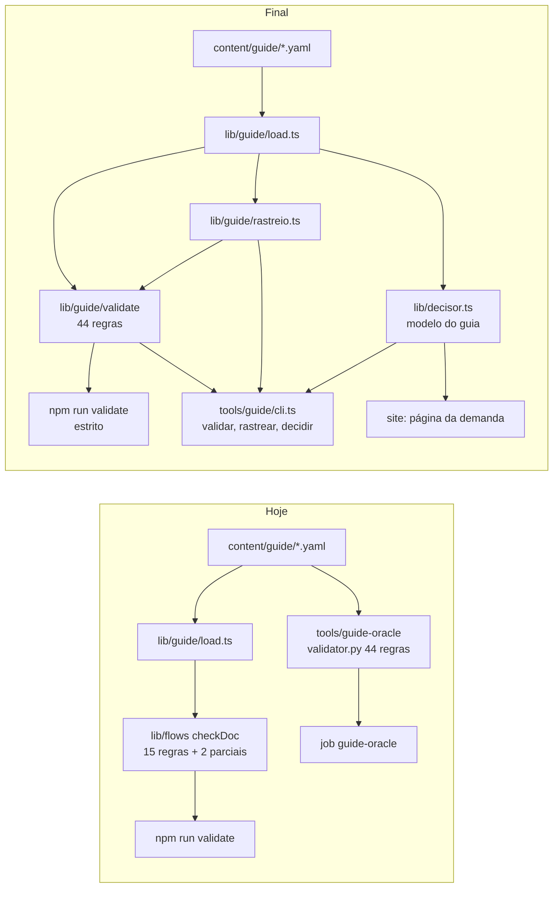

# Design Document

## Overview

Esta etapa troca o validador, o rastreio e o decisor Python do guia por equivalentes em TypeScript dentro do kit, com prova de paridade a cada passo, e depois remove o Python. Ela implementa os Requisitos 1 a 7 de `requirements.md`.

Objetivos de design:

1. **Paridade comprovável.** Cada regra portada passa por um teste diferencial que roda o oráculo Python e o validador TypeScript sobre o mesmo documento e compara os problemas campo a campo.
2. **Um módulo por grupo de regras.** O código segue a mesma divisão da ordem de portabilidade, e cada grupo vira um commit revisável.
3. **Uma fonte por conceito.** O Decisor lê só o bloco do guia, e o rastreio é uma biblioteca única usada pelas regras e pelo comando de linha.
4. **Saída do Python sem perder proteção.** Antes de remover o oráculo, os resultados dele viram arquivos de expectativa versionados, e os testes de propriedade migram para fast-check.

Referências: `docs/guide-rules-parity.md` (44 códigos, ordem dos grupos), `docs/decisor-conflict.md` (opção 1), `docs/adr/0001-yaml-como-fonte-unica.md`, `tools/guide-oracle/src/guia_decisao/validator.py`, `rastreio.py` e `decisor.py`.

## Architecture

### Situação atual e situação final



### Fluxo de validação

A ordem replica `validate()` do Python, porque a ordem define quais problemas aparecem quando há erros em cascata:

1. Schema (`SCHEMA`). Se houver erro de schema, a função devolve só esses problemas e para.
2. Ids únicos, inclusive de dados, subtarefas, papéis, perguntas e ritos (`ID_DUPLICADO`).
3. Transições (`TRANSICAO_INVALIDA`) e bifurcações (`BIFURCACAO_SAIDAS`).
4. Raias (início, fim, transições entre raias, chamadas, ciclos, retornos, orquestradora, cores, padrão de id, demanda consistente).
5. Alcançabilidade por raia (`ORFA`).
6. Pesos do Decisor (`PESOS`).
7. Referências cruzadas e ligações (`REF_QUEBRADA`, `LIGACAO_INCONSISTENTE`).
8. Dados e subtarefas (erros de condição, enum, variante e subtarefa).
9. Avisos, quando `avisos` está ligado.
10. Completude, quando `avisos` e `completude` estão ligados.

### Estratégia de entrega (Requisito 2)

Um único PR na branch `feat/porte-guia-typescript`, com commits em Conventional Commits nesta ordem:

| Commit | Conteúdo |
|---|---|
| 0 `test(guia): harness diferencial contra o oráculo` | Tipo `Problema`, `validateGuide`, modo `--issues` no oráculo, teste diferencial genérico |
| 1 a 7 | Um commit por grupo de regras da ordem de portabilidade |
| 8 `feat(guia): decisor no modelo do guia` | Decisor, site e remoção da `matriz.json` |
| 9 `feat(guia): comando de linha do guia` | `validar`, `rastrear` e `decidir` |
| 10 `test(guia): propriedades em fast-check` | Porte das 32 propriedades do Hypothesis |
| 11 `test(guia): mapa dos testes de navegador` | Requisito 6 |
| 12 `chore(guia): remove o oráculo Python` | Expectativas gravadas, remoção de `tools/guide-oracle` e do job, troca do check obrigatório |

O rastreio entra no commit do grupo 4 (fluxo de dados), porque as regras desse grupo dependem dele.

## Components and Interfaces

### `lib/guide/validate/`

Novo módulo que substitui a lógica de `lib/flows/index.ts`. `lib/flows` passa a reexportar o módulo novo, para não quebrar quem já importa `checkDoc`.

```ts
export type Nivel = 'erro' | 'aviso';
export type Problema = { code: string; nivel: Nivel; path: string; itemId: string | null; message: string };
export type OpcoesValidacao = { avisos?: boolean; completude?: boolean };

export function validateGuide(doc: GuideDoc, schema: object, opcoes?: OpcoesValidacao): Problema[];
```

Arquivos por grupo, cada um exportando uma função pura `(doc) => Problema[]`:

| Arquivo | Grupo | Códigos |
|---|---|---|
| `schema.ts` | base | `SCHEMA` |
| `ids.ts` | 1 | `ID_DUPLICADO` (completo) |
| `estrutura.ts` | base e 2 | transições, bifurcações, raias, `ORFA`, `DEMANDA_INCONSISTENTE`, `COR_DUPLICADA`, `ID_PADRAO` |
| `referencias.ts` | 1 e 2 | `REF_QUEBRADA` (completo), `LIGACAO_INCONSISTENTE`, `PESOS` |
| `dados.ts` | 3 | `CONDICAO_INVALIDA`, `CONDICAO_AUSENTE`, `VARIAVEL_ENUM_SEM_VALORES`, `VARIANTE_DUPLICADA`, `SUBTAREFA_EM_NAO_TAREFA`, `SUBTAREFA_ID_PADRAO` |
| `avisos-dados.ts` | 4 | `VAR_NAO_DECLARADA`, `ENTRADA_SEM_PRODUTOR`, `SAIDA_NAO_ENTREGUE`, `ITEM_SEM_USO`, `TAREFA_SEM_ENTREGAVEL`, `SUBTAREFA_SEM_ENTREGAVEL` |
| `raci.ts` | 5 | `SEM_PAPEL`, `RACI_CONFLITO`, `APROVA_FORA_DE_GATEWAY`, `APROVA_REDUNDANTE` |
| `perguntas.ts` | 6 | `PERGUNTA_SEM_DEPENDENCIA`, `PERGUNTA_SEM_USO`, `PLAYBOOK_SEM_NO` |
| `taxonomia.ts` | 7 | `COMUNICACAO_SEM_DESTINATARIO`, `TIPO_LEGADO`, `SUBTIPO_AUSENTE`, `SUBTIPO_INVALIDO` |
| `completude.ts` | 4 | `LACUNA_DE_DADOS` |
| `caminho.ts` | base | montagem de caminho (`decisoes[3].proximo[0].para`) e `itemIdDoCaminho`, iguais a `_caminho` e `_item_id_do_caminho` |

As mensagens são portadas literalmente do Python. Os auxiliares de normalização de datas (`_normalizar_datas`) ficam em `caminho.ts`.

### `lib/guide/rastreio.ts` (Requisito 3)

```ts
export type FichaDeDado = { id: string; tipo: 'artefato' | 'variavel'; produtores: Ref[]; consumidores: Ref[] };
export type Ref = { demanda: string; raia: string; no: string; subtarefa?: string };

export function rastrearDados(doc: GuideDoc): Record<string, FichaDeDado>;
export function descreverCondicao(cond: unknown): string;
export function usosEmCondicoes(doc: GuideDoc): Record<string, Array<{ no: string; condicao: string }>>;
export function lacunasDeDados(doc: GuideDoc): { semProdutor: string[]; semConsumidor: string[] };
```

Cada função espelha a função homônima de `rastreio.py`, com as mesmas chaves no resultado serializado. `avisos-dados.ts` e `completude.ts` consomem estas funções, nunca uma cópia da lógica.

### `lib/decisor.ts` (Requisito 4)

```ts
export class DecisorError extends Error {}
export type LinhaCriterio = { criterio: string; nota: number; peso: number; contribuicao: number };
export type Avaliacao = { opcao: string; linhas: LinhaCriterio[]; total: number };
export type Resultado = { objetivo: string; recomendada: string; avaliacoes: Avaliacao[]; empate: string[]; justificativa: string };

export function configDoGuia(doc: GuideDoc): DecisorConfig;
export function decidir(config: DecisorConfig, objetivo: string, notas: Notas, contexto?: ContextoFinanceiro): Resultado;
```

- `configDoGuia` lê `comum.decisor_construir_comprar_assinar`.
- Arredondamento em 6 casas, tolerância de empate 1e-9 fixa e desempate pela ordem do guia, como no Python.
- `contexto` só alimenta a justificativa, por meio de uma função `contextoEmTexto` equivalente a `_contexto`.
- O orçamento não aparece em `DecisorConfig`. O portão `com_dcs_g1` continua no fluxo `com_dcs` do guia.
- `content/data/matriz.json` é removido. `site/src/render/flow.ts` passa a montar a tabela a partir de `configDoGuia` e mostra o portão de orçamento e o contexto financeiro, que chegam como texto do guia.

### `tools/guide/cli.ts`

| Comando npm | Uso | Equivalente Python |
|---|---|---|
| `npm run guide -- validar [--estrito] [--sem-avisos] [--parcial] [--json]` | valida o guia | `cli validar` |
| `npm run guide -- rastrear [<id>] [--json]` | mostra produtores, consumidores, usos em condições e lacunas | funções de `rastreio.py` |
| `npm run guide -- decidir --objetivo <id> --notas <arquivo> [--json]` | pontua construir, comprar e assinar | `cli decidir` |

A saída de texto de `validar` segue o formato do Python (`<arquivo>: [aviso ]CODIGO caminho id=<id>: mensagem`) e os mesmos códigos de saída: 0 válido, 1 falha de validação, 2 erro de entrada.

### `tools/validate/checks/flows.ts`

Passa a chamar `validateGuide(doc, schema, { avisos: true, completude: true })` e reprova em qualquer problema. Isso equivale a `validar --estrito`, que o documento real já cumpre hoje no job `guide-oracle`.

### Harness diferencial (`tests/guide/oracle-rules.test.ts`)

- O oráculo ganha o modo `dump_doc.py --issues`, que lê um documento JSON pela entrada padrão e devolve a lista de `Issue` em JSON. A mudança é registrada em `tools/guide-oracle/PATCHES.md`.
- O teste roda com `GUIDE_ORACLE_PYTHON` definido. Ele valida o documento real e cada defeito plantado nos dois lados e compara a chave `(code, nivel, path, itemId)`.
- Defeitos plantados ficam em `tests/guide/defeitos/<CODIGO>.ts`, cada um como uma função `(doc) => doc` que altera uma cópia.
- O job `guide-oracle` passa a instalar Node e Python e roda também esse teste, além de `validar --estrito` e do pytest.

## Data Models

### Problema

| Campo | Tipo | Origem no Python |
|---|---|---|
| `code` | string, um dos 44 códigos | `Issue.code` |
| `nivel` | `erro` ou `aviso` | `Issue.nivel` |
| `path` | string no formato `colecao[i].campo` | `Issue.path` |
| `itemId` | string ou null | `Issue.item_id` |
| `message` | string em português | `Issue.message` |

Chave de comparação na paridade: `code`, `nivel`, `path` e `itemId`. A mensagem é comparada nos testes de defeito plantado.

### DecisorConfig

Formato lido do guia: `criterios: string[]`, `opcoes: string[]`, `escala: { min, max }`, `pesos: Record<objetivo, Record<criterio, number>>`, `ordem_desempate: string[]`. Não há `eixos` nem `eixo_alimenta_criterio`.

### Expectativas gravadas (commit 12)

`tests/guide/expected/` guarda, em JSON, a saída do oráculo para o documento real, para cada defeito plantado, para o rastreio e para casos de referência do Decisor. Esses arquivos substituem o oráculo como prova depois da remoção do Python.

## Correctness Properties

1. **Paridade de problemas.** Para todo documento `d` do conjunto {documento real, documentos com defeito plantado, documentos gerados pelas propriedades}, `chaves(validateGuide(d)) = chaves(oraculo(d))`.
2. **Especificidade do defeito.** Para cada código `C`, o documento com o defeito plantado de `C` produz pelo menos um problema `C`, e o documento real não produz nenhum.
3. **Curto-circuito do schema.** Se existe problema `SCHEMA`, então todos os problemas devolvidos são `SCHEMA`.
4. **Monotonicidade do modo estrito.** O conjunto de problemas com `avisos` desligado está contido no conjunto com `avisos` ligado, e os problemas extras são todos `aviso`.
5. **Pureza.** `validateGuide`, as funções de rastreio e `decidir` não alteram a entrada e devolvem o mesmo resultado para a mesma entrada.
6. **Paridade do rastreio.** Para todo documento, a serialização de `rastrearDados`, `usosEmCondicoes` e `lacunasDeDados` é igual à do `rastreio.py`.
7. **Paridade do Decisor.** Para toda entrada válida, totais, recomendada e empate são iguais aos do `decisor.py`.
8. **Neutralidade do contexto financeiro.** Para toda entrada, `decidir(c, o, n, ctx)` e `decidir(c, o, n)` têm os mesmos totais, a mesma recomendada e o mesmo empate. Só a justificativa muda.
9. **Orçamento fora da pontuação.** Nenhum critério do Decisor é o orçamento, e `DecisorConfig` não aceita campos de eixo.
10. **Ids preservados.** O conjunto de ids em `content/ids.lock.json` depois da etapa contém o conjunto de antes.

## Error Handling

| Situação | Comportamento |
|---|---|
| YAML ilegível ou arquivo ausente | `GuideLoadError` com arquivo e linha; a CLI sai com código 2 |
| Schema inválido no documento | só problemas `SCHEMA`, as demais regras não rodam (propriedade 3) |
| Defeito no documento real | `npm run validate` reprova e lista os problemas no formato da CLI |
| Divergência no teste diferencial | o teste falha e mostra os problemas presentes só no TypeScript e só no Python |
| Objetivo, opção ou critério desconhecido no Decisor | `DecisorError` com mensagem em português que cita o valor recebido |
| Nota fora da escala | `DecisorError` com a opção, o critério, a nota e a escala |
| `GUIDE_ORACLE_PYTHON` ausente localmente | os testes diferenciais são pulados com aviso; o job `guide-oracle` sempre os roda |
| Mudança de resultado no documento real causada por uma regra portada | o PR explica a causa e o dono aprova antes do merge (Requisito 7.5) |

## Testing Strategy

- **Diferencial (Vitest com Python):** documento real e um defeito plantado por código, contra o oráculo. Roda no job `guide-oracle` até o commit 12.
- **Unitário (Vitest):** cada arquivo de `lib/guide/validate/` tem testes com documentos mínimos, e o Decisor tem casos de empate, desempate, escala e contexto.
- **Propriedades (fast-check):** as 32 propriedades de `tests/properties/` portadas uma a uma, com geradores equivalentes a `strategies.py` em `tests/guide/properties/geradores.ts`, mais as propriedades 3, 4, 5 e 8 deste documento.
- **Regressão (Vitest sem Python):** a partir do commit 12, os testes comparam com `tests/guide/expected/`.
- **Navegador:** cada `cdp_*.mjs` ganha uma linha em `docs/guide-browser-tests.md` com o comportamento, se ele existe no site e onde será testado. O que já existe vira teste Playwright contra o build. O resto vira critério de aceite da etapa 3.
- **CI:** `build-test` roda `validate` estrito, testes, build e smoke. O check `guide-oracle` sai no commit 12 e o ruleset da `main` passa a exigir `build-test` sem o oráculo, com a remoção feita pelo script `tools/github/apply-settings.sh`.

## Glossary

- **Chave de comparação:** a tupla `(code, nivel, path, itemId)` usada para dizer se dois problemas são o mesmo.
- **Expectativa gravada:** arquivo JSON com a saída do oráculo, versionado para manter a prova depois da remoção do Python.
- **Defeito plantado:** função que altera uma cópia do documento para disparar um único código de regra.
