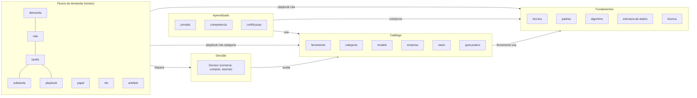
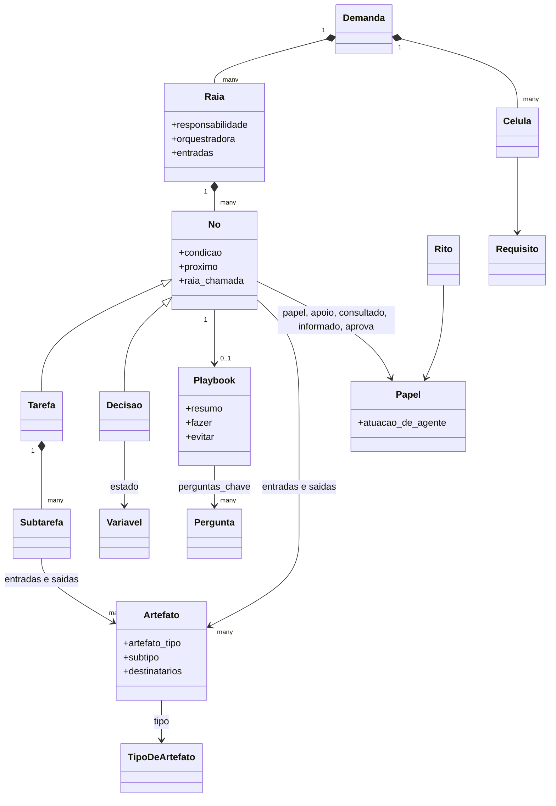
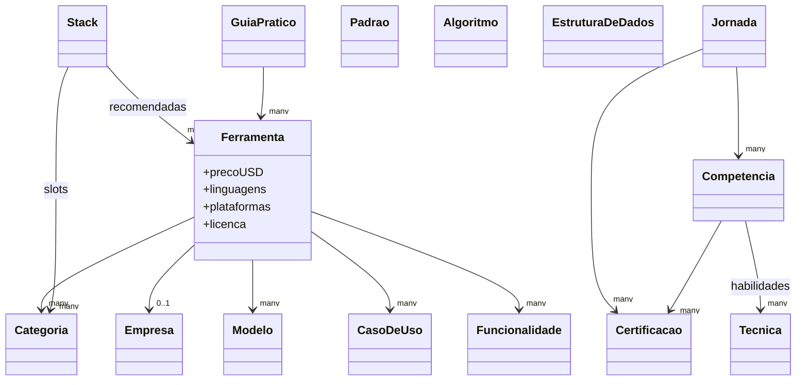

# Modelo de domínio

Descreve os contextos delimitados (DDD), a linguagem ubíqua e as entidades do kit. A fonte da verdade dos campos são os schemas Zod em `lib/schema/`. As regras de conteúdo estão em `docs/content-contract.md`.

## Mapa de contextos

O kit tem cinco contextos. Cada um é dono de um conjunto de tipos e referencia os outros apenas por `id`, nunca copiando conteúdo (princípio "um conceito, uma nota, um tipo").

| Contexto | Responsabilidade | Tipos principais | Fonte |
|---|---|---|---|
| Fluxos de demanda | Dizer o que fazer, quem faz e o que é produzido em cada demanda | `demanda`, `raia`, `tarefa`, `decisao`, `no`, `subtarefa`, `playbook`, `pergunta`, `celula`, `papel`, `rito`, `artefato`, `variavel`, `requisito` | `content/guide/*.yaml` (ADR 0001) |
| Fundamentos | Conceitos reutilizáveis de engenharia | `tecnica`, `padrao`, `algoritmo`, `estrutura-de-dados`, `abordagem`, `estrategia`, `licenca` | `content/pt-BR/fundamentals/` e guia |
| Catálogo | O que existe no mercado e como se combina | `ferramenta`, `categoria`, `caso-de-uso`, `empresa`, `modelo`, `benchmark`, `funcionalidade`, `stack`, `guia-pratico`, `ai` | `content/pt-BR/tools`, `ai`, `stacks`, `guides` |
| Aprendizado | Trilhas e provas de competência | `jornada`, `competencia`, `certificacao` | `content/pt-BR/journeys`, `certifications` |
| Decisão | Pontuar construir, comprar ou assinar, com o orçamento como portão | Decisor, pesos, critérios | `lib/decisor.ts`, bloco `decisor_construir_comprar_assinar` |

### Relações entre contextos

- **Fluxos usam Fundamentos e Catálogo.** O `playbook` aponta para `tecnicas`, `padroes`, `abordagens`, `estrategias` e `categorias_ferramenta`. O fluxo nunca copia o texto da técnica.
- **Catálogo usa Fundamentos.** Uma `ferramenta` referencia `categorias`, `funcionalidades`, `casosDeUso`, `modelos` e `empresa`.
- **Aprendizado depende dos outros.** Uma `competencia` liga `habilidades` (fundamentos) e `certificacoes`. A `jornada` agrupa etapas, certificações e competências.
- **Decisão é um serviço de domínio.** Recebe uma demanda, lê o catálogo e devolve uma justificativa auditável.

## Linguagem ubíqua

| Termo | Significado no kit |
|---|---|
| Demanda | Tipo de trabalho de engenharia (feature, bug, incidente, spike, segurança e as demais). São 12 mais a biblioteca comum |
| Raia | Responsabilidade dentro de uma demanda, como uma raia de diagrama de processo |
| Tarefa e subtarefa | Passo executável de uma raia e seus detalhes |
| Gateway (decisão) | Bifurcação do fluxo. Gateways de qualidade têm `aprova` |
| Papel | Função exercida em uma demanda (PM, Tech Lead, QA e outros). Não é a persona |
| Persona | Quem usa o kit (engenheiro, QA, PM, gerente de engenharia) |
| Rito | Cerimônia recorrente (refinement, planning, review) |
| Playbook | Guia de um nó: resumo, fazer, evitar, perguntas-chave e referências |
| Pergunta-chave | Pergunta que precisa de resposta antes de seguir |
| Artefato | Saída ou entrada de uma tarefa, com `tipo` e `subtipo` de uma lista fechada |
| Célula | Cruzamento de demanda e requisito (funcional ou não funcional) |
| RACI | Responsável (`papel`), apoio, consultado, informado e quem aprova |
| Técnica, abordagem, estratégia, padrão | Fundamentos que o playbook recomenda |
| Ferramenta e categoria | Item do catálogo e o agrupamento dele |
| Stack | Combinação de categorias em slots, com a checklist de setup |
| Guia prático | "Como fazer" passo a passo, ligado às tarefas |
| Jornada e competência | Trilha de aprendizado e a habilidade que ela desenvolve |
| Decisor | Cálculo de construir, comprar ou assinar |
| Wikilink | Referência `[[id]]` resolvida no build |

## Entidades do núcleo (fluxos)

## Entidades dos demais contextos

## Invariantes do domínio

- Um `id` é único entre todos os tipos, em `snake_case` ascii, e nunca muda (`ids.lock.json`).
- Todo nó tem um `papel`. Só gateways de qualidade têm `aprova`.
- Quem é informado não recebe outra letra do RACI no mesmo item.
- Orçamento é portão do Decisor, não peso do score.
- Preço, benchmark e versão trazem fonte e data. Sem confirmação, o valor é `não verificado`.
- Toda relação é navegável nos dois sentidos (relações inversas calculadas no build).
