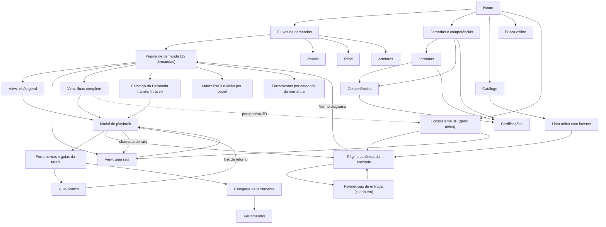
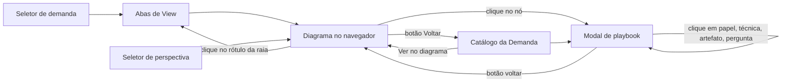
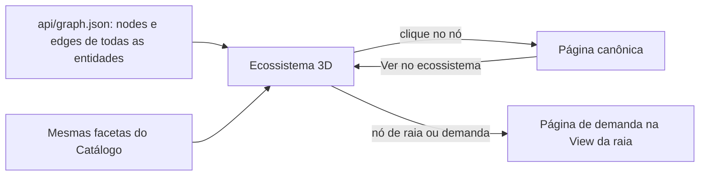
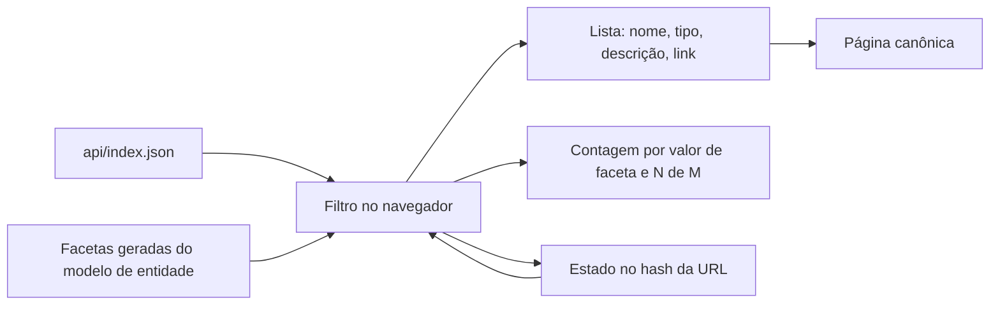
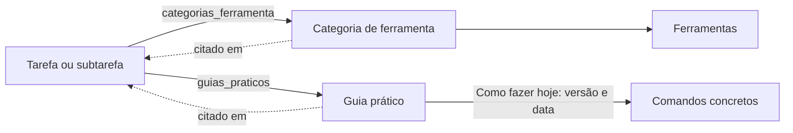
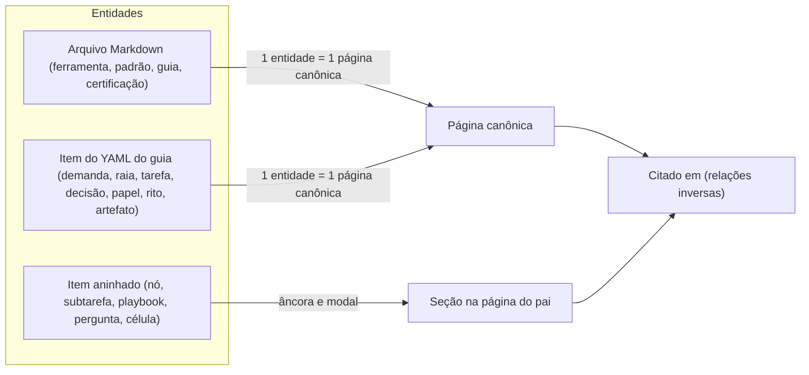

# Estrutura do site

Mapa das páginas, de como as entidades viram rotas e de como a pessoa navega. A fonte é a spec `.kiro/specs/experiencia-fluxos-catalogo/requirements.md` (etapa 3 da migração do guia). As rotas atuais são geradas por `site/src/render/routes.ts` e renderizadas por `site/src/pages/[locale]/[...slug].astro`. O idioma é o primeiro segmento (`/pt-BR/` ou `/en/`).

Estado: as três áreas, o diagrama interativo, o Catálogo filtrável e o grafo 3D descritos aqui são o alvo da spec. Hoje o menu ainda lista 8 camadas. As rotas atuais continuam acessíveis por redirecionamento ou alias (Requirement 1.5).

## Três áreas

O menu principal tem exatamente três entradas, nesta ordem (Requirement 1).

| Área | Conteúdo | Tipos de entidade |
|---|---|---|
| Fluxos de demandas | Um diagrama por demanda, RACI, entradas, saídas, perguntas-chave e a correlação de cada tarefa com técnicas, ferramentas e guias | `demanda`, `raia`, `tarefa`, `decisao`, `papel`, `rito` |
| Jornadas e competências | Trilhas, competências e as certificações que as comprovam | `jornada`, `competencia`, `certificacao` |
| Catálogo | Ferramentas, modelos de IA, fundamentos (técnicas, padrões, estruturas de dados, algoritmos, licenças), stacks, guias práticos, artefatos, categorias, casos de uso e empresas | `ferramenta`, `modelo`, `tecnica`, `padrao`, `algoritmo`, `estrutura-de-dados`, `licenca`, `stack`, `guia-pratico`, `artefato`, `categoria`, `caso-de-uso`, `empresa` e os demais |

Cada tipo pertence a exatamente uma área. O item atual da área recebe `aria-current="page"`. A busca e o seletor de idioma ficam no cabeçalho de todas as páginas.

"Catálogo" nomeia a área e também a tabela de itens de uma demanda (Catálogo da Demanda). O contexto da página diz qual é qual.

## Mapa de navegação

## Página de demanda

A página de demanda é o centro do site. Troca de demanda, de View e de perspectiva acontece sem recarregar a página (Requirements 2, 3, 4, 5 e 6).

| Elemento | Comportamento |
|---|---|
| Seletor de demanda | 12 demandas na ordem de `ordem_das_demandas`. Atualiza a URL |
| Abas de View | `visao`, uma aba por raia na ordem do guia, `completo`. A aba da raia usa a cor da raia |
| Diagrama | Desenhado no navegador a partir do Modelo de Grafo. Arrasta, amplia e responde ao teclado. Cada nó tem `data-id` |
| Alternadores | "Raias" (agrupamentos na View completa) e "Subtarefas" (inclui as condicionais) |
| Modal de playbook | Resumo, fazer, evitar, perguntas-chave, entradas, saídas, técnicas, papéis com letra RACI, ferramentas e guias. Tem histórico e botão voltar |
| Catálogo da Demanda | Artefatos, variáveis, técnicas, nós e subtarefas, com filtros por texto, raia, categoria, tipo, tipo e subtipo de artefato, papel e letra RACI |
| Matriz RACI | Nós nas linhas, papéis nas colunas, letra R, A, C ou I nas células, com visão por papel |
| Sem JavaScript | Lista ordenada de nós por raia com as transições e playbooks em `
` |

Na primeira entrega só a demanda `feature` tem os critérios de aceite e os dados completos. O mecanismo vale para todas as demandas.

## Perspectivas do diagrama

O usuário escolhe como ver o fluxo. As duas perspectivas leem o mesmo Modelo de Grafo (Decisões 5 e 9 da spec).

| Perspectiva | Entrega | Descrição |
|---|---|---|
| `mermaid` | Esta spec | Texto Mermaid gerado do Modelo de Grafo no mesmo build. Provável padrão |
| `3d` | Spec posterior | Perspectiva do Diagrama de uma demanda em WebGL (Three.js). Leva ao grafo do ecossistema |

Modelo de Grafo: `api/flows/<id>.graph.json`, com nós, arestas, raias e metadados, validado por schema versionado no build. O conteúdo do playbook fica fora dele e é resolvido por id.

## Ecossistema 3D

Um grafo único e navegável em 3D, no estilo de [3d-force-graph](https://github.com/vasturiano/3d-force-graph), que representa o **catálogo inteiro** como um ecossistema: cada entidade é um nó e cada relação é uma aresta. É a porta de descoberta do princípio "imersivo sem perder o caminho de trabalho" e complementa as páginas de leitura. Fica em spec posterior (a spec atual entrega só o contrato de dados).

- **Fonte de dados:** `api/graph.json` já contém todas as entidades (`id`, `tipo`, `layer`, `nome`) e as arestas (`source`, `target`, `kind`), inclusive as derivadas do guia. Demandas, raias, tarefas, papéis, ferramentas, técnicas, jornadas e certificações aparecem como nós do mesmo grafo.
- **Agrupamento visual:** por área (Fluxos, Jornadas, Catálogo) e por tipo, com cor por tipo. As raias de cada demanda formam aglomerados.
- **Filtros:** reaproveitam as facetas do Catálogo e o estado no hash, para que a mesma consulta valha na lista e no grafo.
- **Volume:** o guia derivado soma mais de 1.800 entidades (544 playbooks, 451 perguntas, 323 nós e outras), fora o catálogo. O design deve decidir a granularidade: por exemplo, mostrar demanda, raia, tarefa e conceitos como nós e deixar playbooks, perguntas e subtarefas como detalhe ao abrir o nó.
- **Sem JavaScript ou WebGL:** a lista do Catálogo cobre o mesmo conteúdo.

## Catálogo

Uma lista única de todas as entidades da área, com busca por texto e facetas geradas a partir do modelo de entidade (Requirement 11).

- Facetas mínimas: tipo, categoria, linguagem, caso de uso, empresa, domínio, licença e subtipo.
- Filtros diferentes combinam por E. Valores da mesma faceta combinam por OU.
- Uma faceta só aparece para os tipos que têm o atributo.
- O resultado independe da ordem em que os filtros foram aplicados e é igual à filtragem direta de `api/index.json`.
- Botão "Limpar filtros" e mensagem "nenhum item" com sugestão de remover o último filtro.

## Ferramentas e guias a partir de uma tarefa

A ligação vive no YAML do guia (`categorias_ferramenta` e `guias_praticos`). As tarefas ficam agnósticas e os guias práticos carregam o detalhe de cada ferramenta (Requirement 10).

## Estado na URL

O estado fica no fragmento (`location.hash`), então atualizá-lo não recarrega a página, não busca o JSON do grafo de novo e não vai ao servidor (Decisão 8).

| Parte do estado | Onde vale |
|---|---|
| Nó ou modal aberto | Página de demanda |
| View e subtarefas | Página de demanda |
| Perspectiva | Página de demanda |
| Filtros | Catálogo da Demanda, Catálogo, Jornadas e competências |

## Tipos de página

| Tipo de rota | Conteúdo |
|---|---|
| Início de área | Conteúdos da área com o total de cada grupo |
| Página de demanda | Diagrama, modal, Catálogo da Demanda, RACI e ferramentas |
| Catálogo | Lista única filtrável |
| Página canônica | Fatos, corpo em Markdown, relações diretas, "citado em" e, quando citada por um nó, o link "Ver no diagrama" |
| Jornada e competência | Etapas na ordem declarada, meia-vida, orientação de estudo e certificações relacionadas |
| Certificação | Fonte e data para custo, validade e versão do exame, e as jornadas e competências que a citam |
| Busca | Pagefind, offline |
| Ecossistema 3D | Grafo único de todas as entidades (spec posterior) |
| API estática | `api/index.json`, `api/graph.json`, `api/flows/<id>.json` e `api/flows/<id>.graph.json` |

## Relação entre entidades e páginas

Cada entidade tem uma única página canônica, e todo link aponta para ela. `no`, `subtarefa`, `playbook`, `pergunta` e `celula` não têm página própria. Eles aparecem como âncora na página do pai e abrem no modal. Se o link aponta para uma entidade inexistente, o build falha.

## Orçamento de desempenho

| Medida | Limite |
|---|---|
| JavaScript por página | 300 kB gzip |
| Modelo de Grafo por demanda | 200 kB gzip |
| Diagrama interativo (p95, CPU 4 vezes mais lenta) | 2,0 s |
| Troca de View ou de subtarefas | 200 ms |
| Filtro do Catálogo | 100 ms |
| Crescimento de `site/dist` | até 25% sobre a linha de base |
