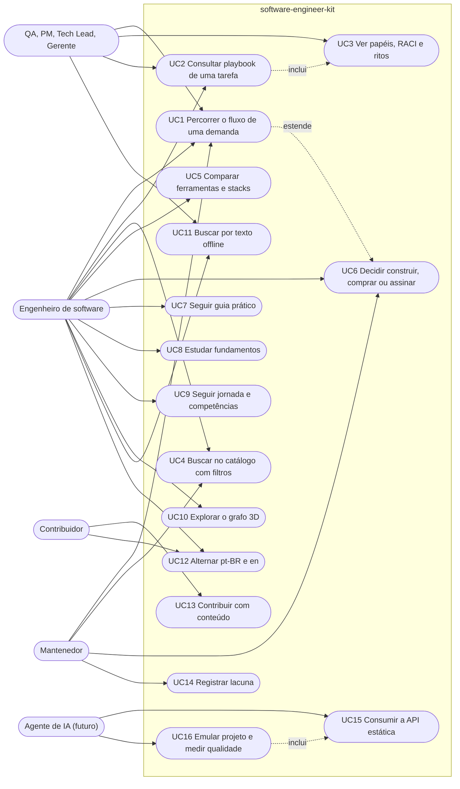
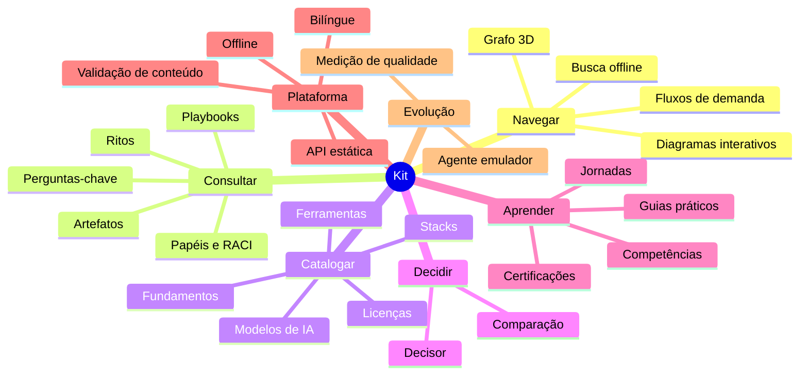

# Casos de uso e funcionalidades

Lista o que o kit faz, para quem, e como cada funcionalidade se liga à entrega. Atores e papéis seguem `docs/prd.md`: persona é quem usa o kit, papel é a função exercida em uma demanda.

## Atores

| Ator | Tipo | Interesse |
|---|---|---|
| Engenheiro de software | Primário | Saber o que fazer e usar em cada demanda |
| QA, PM, gerente de engenharia, tech lead | Secundário | Ver responsabilidades, ritos e artefatos do seu papel |
| Mantenedor | Primário de produto | Consultar antes de decidir e registrar lacunas |
| Contribuidor | Secundário | Ampliar conteúdo e traduções |
| Agente de IA (futuro) | Sistema | Consumir a API estática, executar fluxos e emular projetos |

## Diagrama de casos de uso

## Casos de uso

| ID | Caso de uso | Ator | Resultado | Entrega |
|---|---|---|---|---|
| UC1 | Percorrer o fluxo de uma demanda | Engenheiro, secundários | Navega raias, tarefas e gateways no diagrama interativo | Atual |
| UC2 | Consultar playbook de uma tarefa | Engenheiro, secundários | Vê resumo, fazer, evitar, perguntas-chave, técnicas e ferramentas | Atual |
| UC3 | Ver papéis, RACI e ritos | Secundários | Sabe o que deve ou pode fazer em cada etapa | Atual |
| UC4 | Buscar no catálogo com filtros | Engenheiro, mantenedor | Filtra por tipo, categoria, linguagem, caso de uso e empresa | Catálogo unificado (etapa 3) |
| UC5 | Comparar ferramentas e stacks | Engenheiro | Vê preço, licença e alternativas, com fonte e data | Atual e catálogo |
| UC6 | Decidir construir, comprar ou assinar | Engenheiro, mantenedor | Recebe pontuação e justificativa auditável, com o orçamento como portão | Atual |
| UC7 | Seguir guia prático | Engenheiro | Executa um "como fazer" ligado a uma tarefa | Atual |
| UC8 | Estudar fundamentos | Engenheiro | Lê técnicas, padrões, algoritmos e estruturas de dados | Atual |
| UC9 | Seguir jornada e competências | Engenheiro | Escolhe a trilha e as certificações que comprovam a competência | Atual |
| UC10 | Explorar o grafo 3D | Engenheiro | Descobre relações entre conceitos e volta ao caminho de leitura | Wave B |
| UC11 | Buscar por texto offline | Todos | Encontra páginas pelo Pagefind sem conta ou rede | Atual |
| UC12 | Alternar pt-BR e en | Todos | Lê no idioma escolhido, com marcador de fallback | Atual |
| UC13 | Contribuir com conteúdo | Contribuidor | Abre PR validado por `npm run validate` | Atual |
| UC14 | Registrar lacuna | Mantenedor | Abre issue com rótulo `lacuna` | Atual |
| UC15 | Consumir a API estática | Agente | Lê `index.json`, `graph.json` e `flows/<id>.json` | Atual |
| UC16 | Emular projeto e medir qualidade | Agente | Percorre fluxos, gera artefatos e aponta lacunas | Pós-entrega |

## Exemplo de especificação: UC2

- **Ator:** engenheiro de software.
- **Pré-condição:** a pessoa está na página de uma demanda.
- **Fluxo principal:**
  1. Clica em uma tarefa no diagrama.
  2. O modal mostra o playbook com resumo, fazer, evitar e perguntas-chave.
  3. A pessoa abre uma técnica, um papel ou um artefato citado.
  4. A página do conceito mostra de onde ele é citado e leva de volta ao fluxo.
- **Fluxo alternativo:** sem JavaScript, a pessoa lê o Mermaid em texto e abre a página da tarefa.
- **Pós-condição:** a pessoa sabe o que fazer, quem faz e o que produzir.

## Mapa de funcionalidades

## Requisitos não funcionais

- Site estático, sem conta e sem backend. Funciona offline.
- Bilíngue (pt-BR como fonte, en como overlay) e com fallback explícito.
- Fonte e data em preço, benchmark e versão. Valor não confirmado aparece como "não verificado".
- Páginas de leitura sem JavaScript obrigatório. Ilhas só onde há interação.
- Ids estáveis e links verificados no build.
